<div align="center">


# Noviq.

**A local-first notes workspace with first-class Persian and right-to-left support.**

Block editor · backlinks and graph · spaced-repetition flashcards · optional sync between devices · your notes stay in plain files.

[](https://github.com/AliMirzad/noviq/actions/workflows/release.yml)
[](https://github.com/AliMirzad/noviq/releases)


[Download](https://github.com/AliMirzad/noviq/releases) · [Website](https://alimirzad.github.io/noviq/) · [Privacy](https://alimirzad.github.io/noviq/privacy.html) · [فارسی](README.fa.md)

<br>

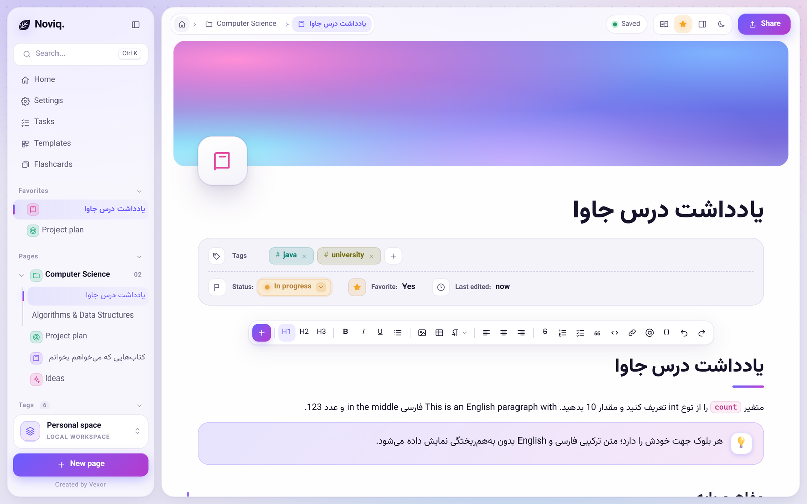

</div>

---

## Why Noviq

Most note apps treat right-to-left text as an afterthought: mixed Persian and English lines scramble punctuation, tables flip the wrong way, and code blocks inherit the wrong direction. Noviq was built the other way round. Direction is decided **per block**, mixed-language text renders correctly, and everything else (tables, lists, callouts, formulas, diagrams) follows.

Your notes are plain files in a folder you own. Nothing needs an account to work. If you want your notes on more than one device, Noviq can keep that folder in sync through the Noviq sync server, which you can run yourself (see [`server/`](server/)). An account is just a user name and a password: no email address, no phone number.

## Features

### Editor

- **Per-block text direction**: `/rtl`, `/ltr`, `/auto`, `Ctrl+Shift+←/→`, and the Word-style left/right `Ctrl+Shift` shortcut.
- **Rich blocks**: headings, lists, checklists, quotes, RTL tables, callouts, collapsible toggles, images, and horizontal rules.
- **Math**: inline and block formulas with KaTeX (`$x$`, `$$`).
- **Diagrams**: write [Mermaid](https://mermaid.js.org/) text and get a live diagram, with zoom/pan and one-click conversion back to code. Pasting Mermaid text is detected automatically.
- **Code blocks**: 24 languages with syntax highlighting, auto-detection, and sensible `Tab` / `Enter` indentation.
- **Markdown-native**: live shortcuts as you type, and raw Markdown paste.
- **Command menu** on `/` and `Ctrl+/` (also works on a Persian keyboard layout); with text selected it transforms the selection.
- **Page links** with `[[`, `@`, or `/link`, plus automatic **backlinks** on every page.
- **Find in page** (`Ctrl+F`) that understands Persian letter variants and ZWNJ.

<table>
<tr>
<td width="50%">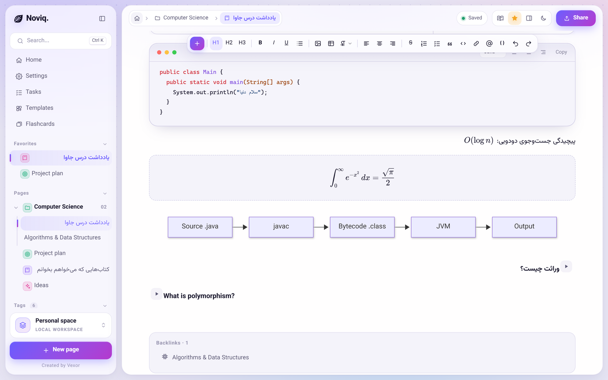</td>
<td width="50%">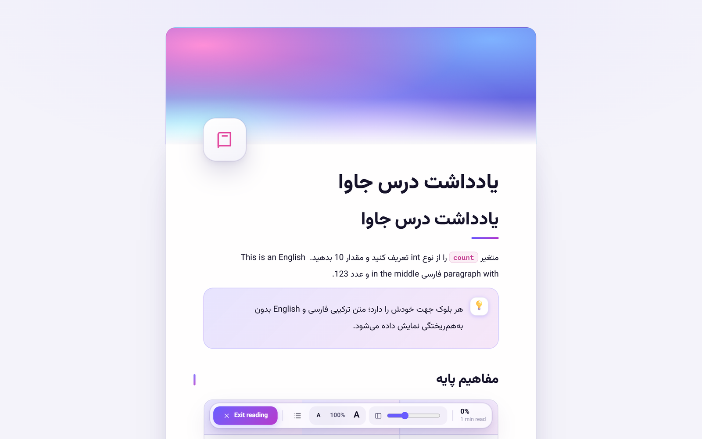</td>
</tr>
<tr>
<td align="center"><sub>Code, KaTeX formulas, Mermaid diagrams, toggles and backlinks</sub></td>
<td align="center"><sub>Reading mode: distraction-free, adjustable text size and width, progress</sub></td>
</tr>
</table>

### Workspace

- **Pages, sub-pages and folders** with drag and drop, favorites, icons and gradient or image covers.
- **Tags and status** (to do / in progress / done) on every page, and a sortable, filterable **Pages table**.
- **Graph view** of how your pages link together, for the whole vault or around the current page.
- **Quick search and command palette** on `Ctrl+K`.
- **Templates**: lecture, chapter summary, exercise, meeting notes, to-do list.
- **Reading mode** (`Ctrl+.`): a read-only, paper-like view with outline and progress.
- **Print / PDF** with clean print styles.
- **Appearance**: light, dark or system theme, accent colors, backgrounds, editor fonts, and an English / Persian interface.

<table>
<tr>
<td width="50%">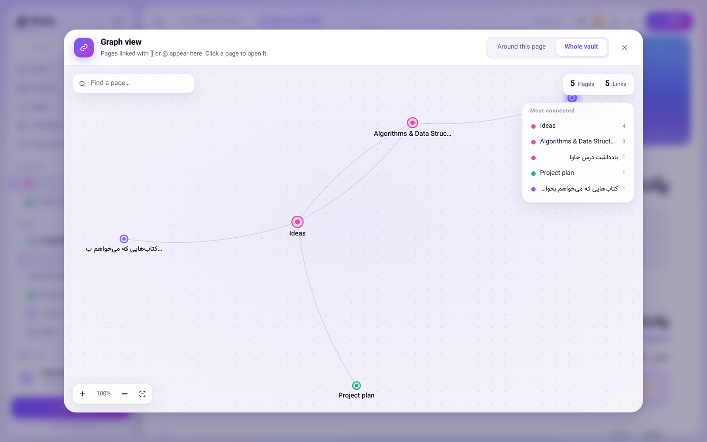</td>
<td width="50%">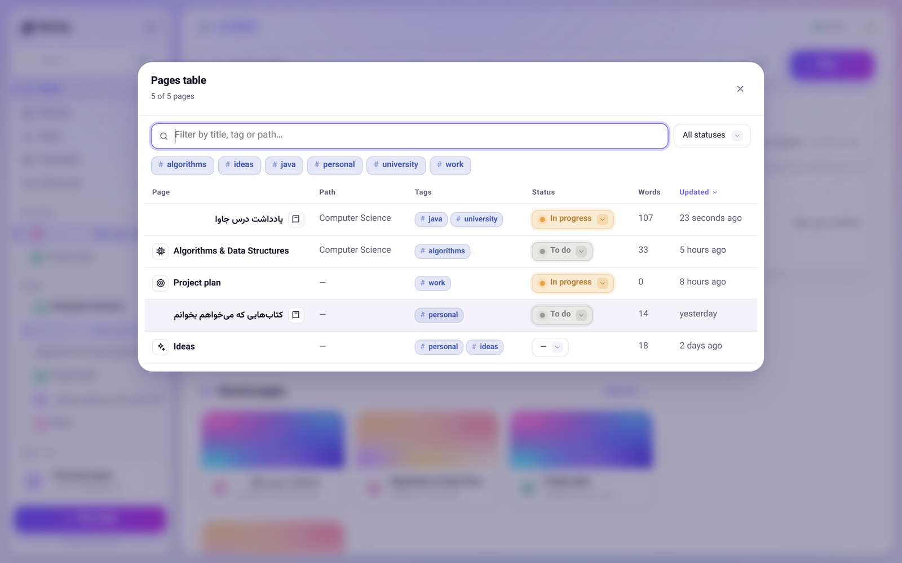</td>
</tr>
<tr>
<td align="center"><sub>Graph view</sub></td>
<td align="center"><sub>Pages table</sub></td>
</tr>
<tr>
<td width="50%">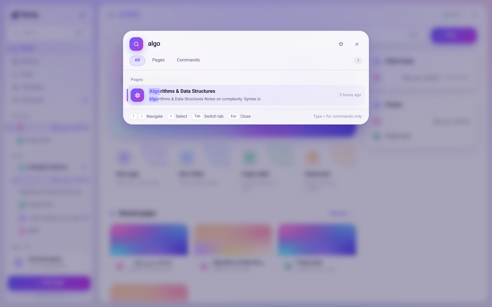</td>
<td width="50%">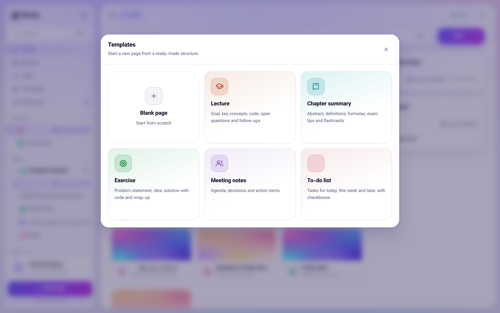</td>
</tr>
<tr>
<td align="center"><sub>Quick search (<code>Ctrl+K</code>)</sub></td>
<td align="center"><sub>Templates</sub></td>
</tr>
</table>

### Study

- **Flashcards from your notes**: every toggle block is a card (title is the question, content is the answer).
- **Spaced repetition** (SM-2 style) with *again / hard / good / easy* grading, per page or across the whole vault.

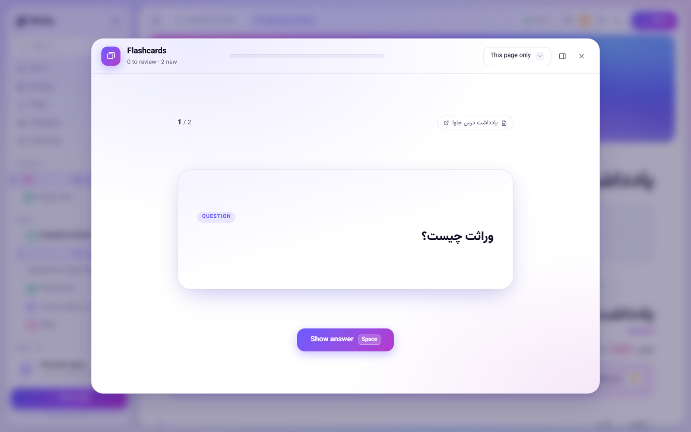

### Your data

- **Open files, not a database.** Pages are JSON, attachments are content-addressed files.
- **Version history**: up to 40 versions per page, with preview and restore.
- **30-day trash**; unreferenced images are cleaned up after a grace period.
- **Import** Markdown files and **Obsidian vaults** (folders, `[[links|alias]]`, `![[images]]`, `#tags`, front matter, callouts).
- **Export** to a zip (folder structure, `assets/`, front matter) or a JSON backup.

### Make it yours

<table>
<tr>
<td width="50%">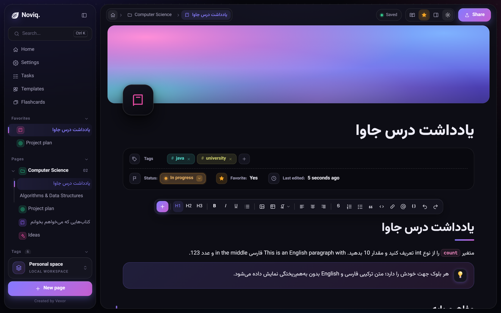</td>
<td width="50%">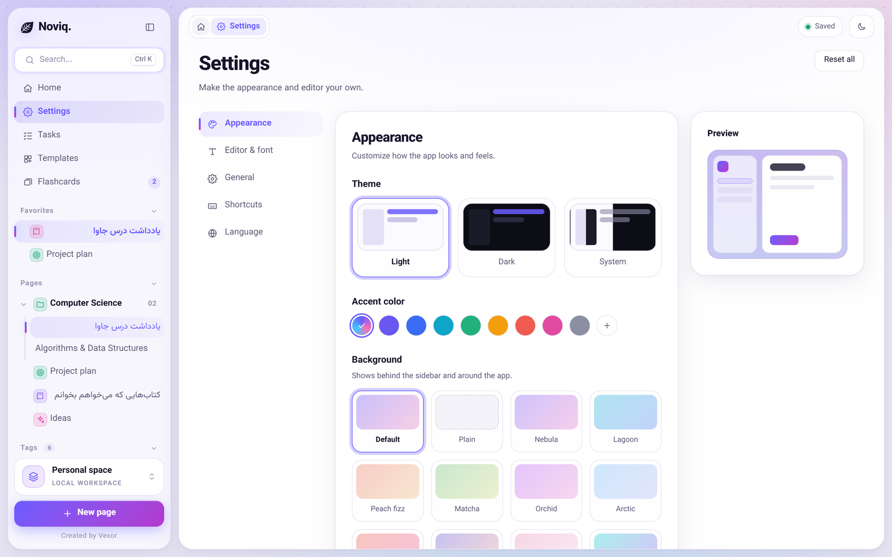</td>
</tr>
<tr>
<td align="center"><sub>Dark theme</sub></td>
<td align="center"><sub>Themes, accent colors and backgrounds</sub></td>
</tr>
</table>

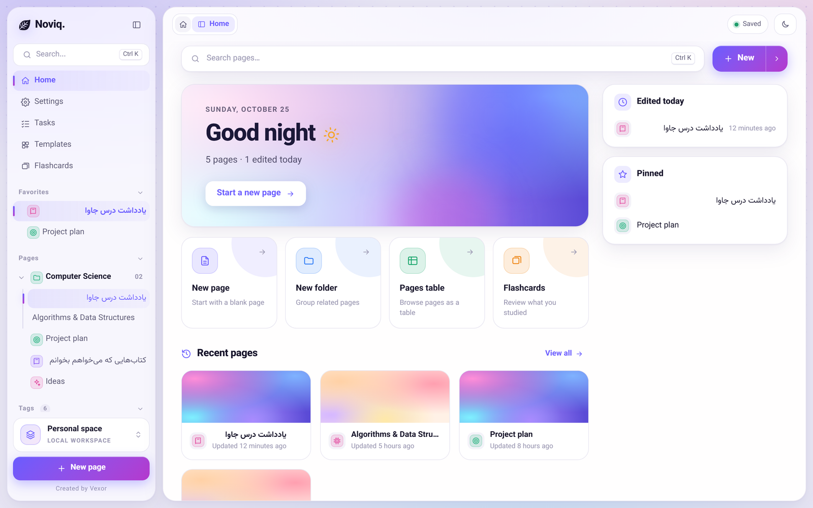

## Download

Get the latest installer from the **[Releases](https://github.com/AliMirzad/noviq/releases)** page:

| Platform | File |
|---|---|
| Windows 10 / 11 | `.exe` (NSIS) or `.msi` |
| macOS (Intel and Apple Silicon) | `.dmg` (universal) |

> **First-run warnings.** Installers are not code-signed yet.
> On **Windows**, SmartScreen may show *Unknown publisher*: choose *More info → Run anyway*.
> On **macOS**, right-click the app and choose *Open* the first time.

## Sync between devices

Sync is optional. It needs a Noviq sync server: the app uses `https://sync.manaz.pro` by default, and the **Server** field of the sign-in form points it at your own.

1. Click the sync button in the top bar (or **Settings → Data → Account and sync**) and **create an account**: a user name and a password. Save the **recovery key** that is shown once: it is the only way to choose a new password if you forget yours.
2. Turn on sync for your workspace. A change on one device reaches your other devices within about a second.
3. Install Noviq on another computer, sign in, and download the vault.

What to know:

- **Fast.** The app holds one request open to the server and is told the moment another device saves; only what changed travels.
- **Safe on a bad connection.** Your edits are written to your disk first. When the connection drops they wait and go out when it is back; a file that is merely missing is never read as "deleted", and deleted files stay recoverable for 30 days.
- **Two devices, one page.** Nothing is silently overwritten: the newer edit wins and the older one is kept in that page's history. Different pages never conflict.
- The device token is stored in the operating system's credential store (Windows Credential Manager / macOS Keychain).
- Your notes are stored on the server in your account (not yet end-to-end encrypted). See the **[Privacy Policy](https://alimirzad.github.io/noviq/privacy.html)**.

The server is in [`server/`](server/) (Node.js, S3-compatible storage, SQLite): [how to run it](server/README.md).

## How your data is stored

A **vault** is an ordinary folder (default `Documents/Noviq`), the single source of truth. Everything else is derived and rebuildable.

```
MyVault/
  .noviq/vault.json            vault format version
  pages/<id>.json              one file per page or folder (TipTap document + metadata)
  files/ab/<sha256>            attachments, content-addressed (never conflict)
  history/<pageId>/<ts>.json   previous versions of a page (up to 40)
  kv/<key>.json                synced settings (e.g. flashcard schedule)
  .trash/                      deleted items, purged after 30 days
```

Design notes: file names are IDs, not titles, so renames and moves never create conflicts; every write is atomic (temp file → `fsync` → rename); one edit touches exactly one file. The reasoning is in [ADR-0003](docs/adr/0003-vault-and-sync.md).

## Built with

| | |
|---|---|
| Shell | [Tauri 2](https://tauri.app/) (Rust) |
| UI | React 19, TypeScript, Vite |
| Editor | [TipTap 3](https://tiptap.dev/) (ProseMirror) |
| Math / diagrams | KaTeX, Mermaid |
| Storage | Plain files in a vault folder; IndexedDB when run in a browser |
| Sync | Noviq sync server ([`server/`](server/): Node.js, S3, SQLite): revisions with compare-and-swap, long-poll notifications |

## Build from source

**Prerequisites:** Node.js 22.18+, Rust (stable), and the [Tauri prerequisites](https://tauri.app/start/prerequisites/) for your OS (on Windows: Visual Studio Build Tools with *Desktop development with C++*; on macOS: Xcode Command Line Tools).

```bash
git clone https://github.com/AliMirzad/noviq.git
cd noviq/spike/tiptap
npm install
```

Run the desktop app in development:

```bash
npm run tauri dev
```

Or run just the web UI in a browser (uses IndexedDB and its own sample content):

```bash
npm run dev          # http://localhost:5173
```

Build installers for your platform (output in `src-tauri/target/release/bundle/`):

```bash
npm run tauri build
```

### The sync server in your own build

The app talks to the server named by the build-time environment variable `NOVIQ_SERVER` (default `https://sync.manaz.pro`). Users can also type another address under **Server** on the sign-in form. Without a reachable server the app works fully offline; only syncing waits.


### Tests

```bash
# Node 22.18+ (uses node:sqlite and runs TypeScript directly)
for t in schema crash zip detect srs mermaid-detect; do node db/test-$t.mjs; done
node db/check-i18n.mjs                         # t('…') strings missing a Persian translation
cd spike/tiptap/src-tauri && cargo test        # Rust: vault, index, sync engine, server client
cd server && npm test                          # the sync server (Node 22.13+)
cd .. && npx tsc -b                            # type check
```

## Releasing

Installers for Windows and macOS are built by [GitHub Actions](.github/workflows/release.yml).

1. Bump `version` in `spike/tiptap/src-tauri/tauri.conf.json`, `Cargo.toml` and `package.json`.
2. Optionally set the repository variable `NOVIQ_SERVER` to compile in the address of your own sync server.
3. Tag and push:
   ```bash
   git tag v0.1.0
   git push origin v0.1.0
   ```
4. Review the draft release that the workflow creates, then publish it.

## Repository layout

| Path | Contents |
|---|---|
| `spike/tiptap/` | The app: React UI (`src/`) and the Tauri shell (`src-tauri/`) |
| `spike/tiptap/src-tauri/src/` | Rust: `vault`, `index`, `registry`, `legacy` migration, and `sync/` (the engine, the account, the server client) |
| `server/` | The sync server: accounts, revisions, blobs on S3, instant change notification |
| `db/` | SQLite migrations, Persian normalization, and the Node test suite |
| `docs/` | Design docs, [architecture decision records](docs/adr/), and the project site |

## Roadmap

- Code-signed installers (Windows and macOS) and automatic updates
- Mobile apps (iOS / Android) on the same vault format
- Live co-editing of one page (CRDT) on top of the sync server, and end-to-end encryption of synced notes
- A local SQLite index for full-text search and backlinks on very large vaults

## Privacy

Noviq runs on your computer. It has no analytics or telemetry and sends your notes nowhere unless you turn on sync; then they go to the sync server you signed in to (by default `sync.manaz.pro`, or your own). Full details: [Privacy Policy](https://alimirzad.github.io/noviq/privacy.html).

---

<div align="center">
<sub>Made by Vexor.</sub>
</div>
