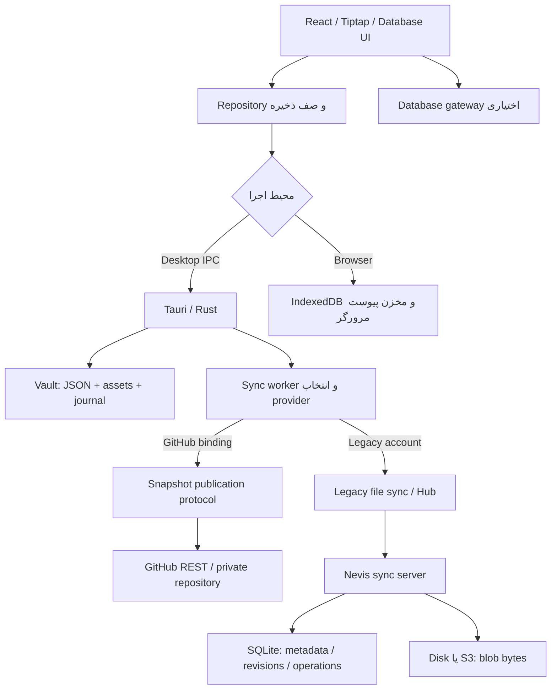
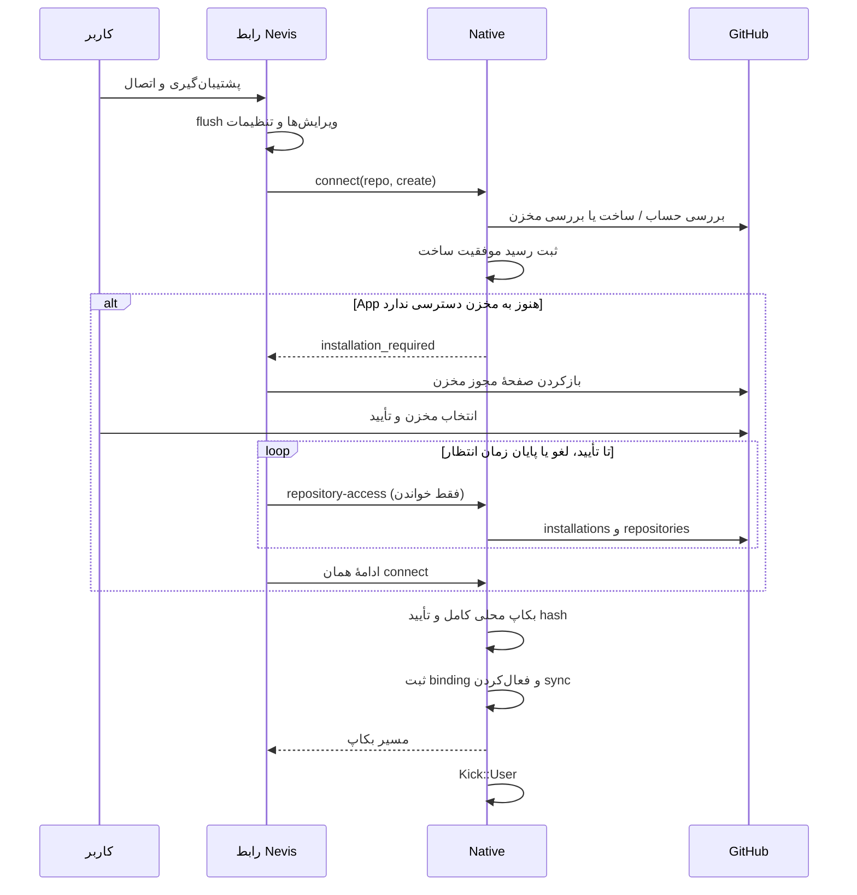

# معماری فعلی همگام‌سازی Nevis

تاریخ تدوین: ۲۰۲۶-۱۰-۲۸. دامنه: کد برنچ `sync/github-personal-vaults`، شامل مسیر GitHub، سازگاری با سرور قدیمی، ذخیرهٔ محلی و رابط رفع تداخل. وجود قابلیت در این سند به معنی استقرار سرویس، عبور تست روی همهٔ دستگاه‌ها یا انتقال واقعی دادهٔ کاربر نیست. این سند وضعیت پیاده‌سازی را شرح می‌دهد، نه طرح پیشنهادی آینده.

## ۱. مدل کلی

Nevis برنامه‌ای local-first است: ویرایش و ذخیرهٔ محلی به اتصال اینترنت وابسته نیست. روی دسکتاپ، پوشهٔ Vault دادهٔ مرجع است؛ در مرورگر، IndexedDB این نقش را دارد. سینک وظیفه دارد تغییرات نسخه‌های محلی و راه‌دور را با حفظ نسخه‌های متعارض جابه‌جا کند.

در کد فعلی دو موتور شبکه وجود دارد. موتور جدید GitHub از snapshot و commit استفاده می‌کند؛ موتور قدیمی با API سرویس `server/` و تغییرات فایل‌محور کار می‌کند. این دو صرفاً دو adapter برای یک الگوریتم واحد نیستند: قرارداد provider جدید در `sync/provider.rs` و قرارداد قدیمی `Remote` در `sync/mod.rs` الگوریتم، state و قواعد حذف متفاوت دارند.



| بخش | مسئولیت | کد مرجع |
|---|---|---|
| ادیتور و مدل صفحه | ویرایش، debounce، تاریخچه و دریافت تغییر خارجی | `spike/tiptap/src/PageView.tsx`, `src/repo.ts` |
| لایهٔ ذخیرهٔ مشترک | انتخاب IPC یا IndexedDB، صفحات و kv | `spike/tiptap/src/db.ts` |
| دادهٔ پایگاه‌داده | record، batch، journal، undo و index | `src/database/storage/`, `src-tauri/src/database/` |
| مدیریت فضای کاری | مسیر محلی، شناسه و فضای کاری باز | `src-tauri/src/registry.rs`, `vault.rs` |
| هماهنگی سینک | commandها، thread، زمان‌بندی و وضعیت | `src-tauri/src/main.rs` |
| snapshot جدید | inventory، hash، merge، tombstone و apply | `src-tauri/src/sync/snapshot.rs` |
| پروتکل انتشار | checkpoint، pending و بازیابی نتیجهٔ نامعلوم | `src-tauri/src/sync/provider.rs` |
| adapter گیت‌هاب | ورود، مجوز مخزن و Git Database API | `src-tauri/src/sync/github.rs`, `network.rs` |
| مسیر قدیمی | مقایسهٔ فایل و adapter سرور | `src-tauri/src/sync/mod.rs`, `hub.rs`, `account.rs` |
| رابط اتصال/تداخل | راه‌اندازی، وضعیت، انتخاب نسخه و رندر سند | `src/GitHubSync.tsx`, `ConflictReview.tsx`, `ConflictDocument.tsx` |

مسیرهای کوتاه `src/` و `src-tauri/` در ادامه نسبت به `spike/tiptap/` هستند.

## ۲. مالکیت و محل نگهداری داده

### ۲.۱ Vault دسکتاپ

```text
<vault>/
  .noviq/vault.json                 شناسه و مشخصات محلی Vault
  pages/<page-id>.json              سند و metadata صفحه
  databases/<kind>/<encoded-id>.json
  files/<sha-prefix>/<sha256>       بایت‌های پیوست
  files/<sha-prefix>/<sha256>.json  مشخصات پیوست
  kv/*.json                        داده‌ها و تنظیمات مجاز
  conflicts/<uuid>.json             نسخه‌های کامل یک تداخل
  history/...                      تاریخچهٔ صفحه و record
  .trash/...                       نسخه‌های محلی حذف‌شده
  .noviq/tombstones.json            حذف‌های صریح برای snapshot
  .noviq/snapshot-apply.json         journal اعمال snapshot
  .noviq/database-journal/...       journal batch پایگاه‌داده
  .noviq/database-ops/...           نتیجهٔ عملیات برای retry همسان
  .noviq/database-undo.json         undo محلی
  .noviq/workflow-runtime/...       runtime محلی
  .noviq/index.db                   index قابل بازسازی
```

بازکردن Vault موجود با ساختن Vault فرق دارد. `Vault::open_as` وجود پوشه و هویت آن را بررسی می‌کند؛ ناپدیدشدن پوشه نباید به ساخت یک Vault خالی و سپس حذف دادهٔ راه‌دور منجر شود. عملیات adopt/create فقط در جریان صریح انتخاب یا ساخت فضای کاری انجام می‌شود.

نوشتن فایل با `write_atomic` از مسیر فایل موقت، flush/fsync و rename انجام می‌شود. atomic بودن هر فایل به‌تنهایی یک تراکنش چندفایلی نمی‌سازد؛ batch پایگاه‌داده و اعمال snapshot برای این منظور journal جدا دارند.

### ۲.۲ اطلاعات محلی دستگاه

در app-data، خارج از Vault:

- `config.json`: فهرست Vaultها، مسیر هرکدام، پرچم `sync` و Vault جاری.
- `github/<vault-id>/binding.json`: صاحب مخزن، شناسهٔ عددی مالک و مخزن، نام مخزن، branch، سیاست زمان‌بندی و مسیر بکاپ مهاجرت.
- `github/<vault-id>/<repo-id>/base.json`: revision و snapshot آخرین checkpoint پذیرفته‌شده.
- همان پوشه، `pending.json`: parent، commit کاندید و snapshotهای قبل و بعد از انتشار.
- `github/<vault-id>/setup-<owner-id>-<repo>.json`: رسید ساخت مخزن، برای ادامهٔ راه‌اندازی بدون ساخت دوباره.
- `github/backups/<vault>-<timestamp>/`: بکاپ پیش از تغییر provider.
- state و `account.json` مسیر قدیمی، جدا از state گیت‌هاب.

Credential Store سیستم‌عامل محل نگهداری توکن‌های GitHub است. مسیر Vault و تنظیمات دستگاه به مخزن دادهٔ کاربر فرستاده نمی‌شوند.

### ۲.۳ مرورگر و پایگاه‌داده

در مرورگر، صفحات، نسخه‌ها، kv و storeهای پایگاه‌داده در IndexedDB نگهداری می‌شوند. پیوست‌ها نیز storage مرورگر دارند. ورود و سینک GitHub فعلی به commandهای native وابسته است و نسخهٔ صرفاً مرورگری همان سرویس سینک GitHub را اجرا نمی‌کند.

در دسکتاپ، recordهای پایگاه‌داده JSON مرجع هستند؛ SQLite محلی برای جست‌وجو/index است. ۱۳ نوع record عبارت‌اند از container، source، property، view، relation، edge، template، workflow، comment، principal، grant، event و allocator. هویت‌ها و روابط با همان IDها منتقل می‌شوند؛ برای رفع تداخل، ردیف جدید با ID تصادفی به‌عنوان جایگزین ردیف اصلی ساخته نمی‌شود.

## ۳. مسیر ذخیره و نمایش تغییرات خارجی

۱. Tiptap ویرایش را در حافظه نگه می‌دارد و با debounce حدود ۴۰۰ میلی‌ثانیه آن را به Repository می‌رساند.
۲. Repository نوشتن‌های محلی را صف می‌کند؛ API مشترک به IPC دسکتاپ یا تراکنش IndexedDB می‌رود. خطای نوشتن باعث حفظ درخواست‌های pending و اعلام `storage-error` می‌شود.
۳. backend تغییر محلی را با `Kick::Edit` به worker اعلام می‌کند. ذخیرهٔ موفق محلی نیازمند موفقیت HTTP نیست.
۴. دکمهٔ سینک دستی ابتدا `saveForSync` را اجرا می‌کند: ذخیرهٔ ادیتورهای ثبت‌شده، flush صف Repository و flush تنظیمات مشترک؛ سپس `sync_now` را فراخوانی می‌کند.
۵. `sync_now` درخواست اجرای worker است. پایان IPC آن به‌تنهایی به معنی تکمیل آپلود نیست؛ وضعیت worker و `lastAt` نتیجهٔ اجرای بعدی را نشان می‌دهند.
۶. پس از تغییر محلی ناشی از سینک، backend رویداد `vault-changed` می‌فرستد. Repository در دسکتاپ با رویداد، focus و پایش حدود ۳ ثانیه‌ای fingerprint پوشه تازه می‌شود؛ تا وقتی دادهٔ ذخیره‌نشده در صف دارد، refresh خارجی را عقب می‌اندازد.
۷. ادیتور سند parse‌شده را با سند فعلی مقایسه می‌کند. تأیید همان ذخیره با ترتیب متفاوت کلیدهای JSON، selection و undo را reset نمی‌کند. جایگزینی واقعی سند selection معتبر و اسکرول را حفظ، و undo متعلق به سند قبلی را پاک می‌کند. ویرایش ذخیره‌نشده پیش از جایگزینی باید archive شود؛ شکست archive جلوی جایگزینی را می‌گیرد.

## ۴. انتخاب provider و هم‌زمانی

وجود binding گیت‌هاب بر routing اولویت دارد. اگر binding وجود نداشته باشد، مسیر قدیمی با حساب سرور بررسی می‌شود. ثبت در Registry به‌تنهایی به معنی سینک همهٔ Vaultها در پس‌زمینه نیست: worker فعلی `current_entry`، یعنی فضای کاری باز، را پردازش می‌کند.

پرچم `sync` توقف/ادامهٔ فضای کاری را کنترل می‌کند. قطع اتصال گیت‌هاب binding را کنار می‌گذارد و sync را خاموش می‌کند؛ به‌صورت پنهانی به سرور قدیمی برنمی‌گردد. فایل binding خراب هم نباید به جابه‌جایی بی‌اطلاع provider تبدیل شود.

دو سطح قفل مهم وجود دارد:

- `github::OPERATION`: سریال‌کردن عملیات provider، تغییر اتصال و گردش توکن؛ درخواست شبکه می‌تواند زیر این قفل باشد.
- قفل Vault در `with`: snapshot گرفتن، backup سازگار، resolve و apply جدید با نوشتن‌های native هماهنگ می‌شوند. شبکهٔ GitHub خارج از این قفل Vault انجام می‌شود.

پس «هیچ قفلی در زمان HTTP گرفته نمی‌شود» بیان دقیقی نیست. هدف، نگه‌نداشتن قفل نویسندگان Vault در زمان شبکه است. این قفل‌ها درون همان process هستند و دو برنامه یا ابزار خارجی که هم‌زمان یک پوشه را می‌نویسند، تراکنش مشترک ندارند.

## ۵. ورود و راه‌اندازی GitHub

### ۵.۱ هویت App و توکن

Client ID و slug عمومی هنگام build از `github-app.public.json` یا متغیرهای محیطی خوانده می‌شوند. build script فقط فیلدهای عمومی مشخص‌شده را می‌پذیرد. Client Secret و کلید خصوصی در این جریان در برنامه قرار نمی‌گیرند.

Device Flow در `github.rs` اجرا می‌شود: شروع، نمایش کد، بازکردن صفحهٔ GitHub، رعایت interval/انقضا و poll نتیجه. کد دستگاه فقط در حافظه است. جفت access/refresh token به‌همراه هویت حساب در یک credential سیستم‌عامل ذخیره می‌شود؛ refresh زیر قفل سریال می‌شود. نسخهٔ preview credential service مستقل دارد. خطای دسترسی Keychain/Credential Manager برای گیت‌هاب موجب fallback به فایل توکن نمی‌شود.

ورود به حساب با نصب App روی یک مخزن یکی نیست. دسترسی مؤثر از حساب کاربر و مجوز نصب App محدود می‌شود. برنامه مالکیت شخصی، مخزن خصوصی، غیرآرشیوی‌بودن، repo ID و owner ID را بررسی می‌کند؛ نام مخزن به‌تنهایی هویت امن آن نیست.

### ۵.۲ اتصال اولیه



رسید ساخت جلوی POST تکراری پس از یک ساخت موفق ولی راه‌اندازی ناتمام را می‌گیرد. پاسخ نامعلوم شبکه هنگام ساخت به معنی موفقیت یا شکست قطعی نیست؛ برنامه آن را با `repository_creation_uncertain` اعلام می‌کند. مخزن ایجادشده خودکار حذف نمی‌شود.

مرحلهٔ مجوز، خطای اینترنت نیست. UI صفحهٔ GitHub را باز و دسترسی را با درخواست فقط‌خواندنی بررسی می‌کند؛ پس از تأیید، اتصال اولیه خودکار ادامه می‌یابد. لغو/بستن پنجره ادامه را متوقف می‌کند؛ انتظار بعد از ۱۵ دقیقه پایان می‌یابد و خطاهای دیگر چرخهٔ ادامه را قطع می‌کنند. خود برنامه تأیید کاربر در GitHub را دور نمی‌زند.

مخزن خالی در مسیر راه‌اندازی قابل initialize است. اما 404 یا snapshot ناپدیدشده در یک اتصال برقرار، مجوز درنظرگرفتن remote به‌عنوان «فضای خالی برای بازنویسی» نیست.

## ۶. قالب snapshot گیت‌هاب

دادهٔ هر Vault در مخزن زیر `vaults/<vault-id>/` قرار دارد. چند Vault می‌توانند در یک مخزن باشند.

```text
vaults/<vault-id>/
  manifest.json
  pages/<page-id>.json
  databases/<kind>/<encoded-id>.json
  files/<prefix>/<sha256>[.json]
  kv/<allowlisted-key>.json
  conflicts/<conflict-id>.json
```

`Snapshot` شامل format، vault ID، inventory مسیر به SHA-256 و مجموعهٔ tombstone است. `Bundle` همان manifest به‌همراه بایت‌های فایل‌هاست؛ داده در stateهای JSON با encoding لازم نگهداری و هنگام decode دوباره اعتبارسنجی می‌شود.

JSON canonical ترتیب کلیدهای object را پایدار می‌کند؛ ترتیب آرایه‌ها و دادهٔ سند حفظ می‌شوند. هویت فایل پیوست از SHA-256 بایت‌های آن است. فایل همراه JSON مشخصات پیوست دارد. GIF به‌عنوان همان بایت‌های فایل منتقل می‌شود.

allowlist مسیر جدید شامل صفحات، ۱۳ نوع record، پیوست‌ها، conflictها و این kvهاست: `settings`، `templates`، `tags`، `srs`، `reviewlog`، `savedSearches`، `tasksInbox`، `preferences` و `workspace`. فایل موجود خارج از allowlist وارد snapshot نمی‌شود. history محلی، journal، index، credential و `.git` جزو این snapshot نیستند.

خواندن remote از tarball یک commit مشخص انجام می‌شود؛ آرشیو روی فایل‌سیستم extract نمی‌شود. نوع entry، مسیر، inventory، اندازه و hashها بررسی می‌شوند. مسیر دارای traversal، symlink، نام رزروشدهٔ ویندوز، برخورد حروف بزرگ/کوچک یا manifest ناقص پذیرفته نمی‌شود.

## ۷. الگوریتم سه‌طرفه و انتشار

### ۷.۱ reconcile

ورودی‌ها `base` آخرین checkpoint، `local` snapshot فعلی و `remote` snapshot یک revision ثابت هستند.

| وضعیت | تصمیم کلی |
|---|---|
| local و remote برابرند | همان نسخه |
| فقط local نسبت به base عوض شده | local |
| فقط remote نسبت به base عوض شده | remote |
| فایل بدون tombstone از یکی از inventoryها غایب است | غیبت به‌تنهایی مجوز حذف نیست |
| کلیدهای مستقل metadata صفحه/kv عوض شده‌اند | ادغام کلیدهای مستقل |
| همان بخش سند، آرایه یا record از هر دو طرف عوض شده | archive تداخل با سه نسخه |
| حذف صریح با ویرایش database record برخورد کرده | حفظ archive حذف/ویرایش برای تصمیم کاربر |

بدنهٔ سند واحد تقسیم‌ناپذیر است؛ CRDT، OT یا ادغام خودکار پاراگراف/خط وجود ندارد. record پایگاه‌داده هم در موتور GitHub واحد کامل است. در تداخل معمول، نسخهٔ جاری حفظ می‌شود و base/local/remote کامل در فایل conflict قرار می‌گیرند؛ timestamp به‌تنهایی جای archive را نمی‌گیرد.

### ۷.۲ پروتکل provider

`SnapshotProvider` عملیات `check`، `head`، `read`، `published`، `stage` و `publish` را ارائه می‌دهد. revision بیرون adapter opaque است. provider باید قابلیت انتشار محافظت‌شده را اعلام کند؛ adapter بدون آن رد می‌شود.

چرخهٔ معمول:

۱. بررسی هویت و سیاست دسترسی؛ رسیدگی به pending قبلی.
۲. capture محلی و load کردن `base.json`.
۳. pin کردن head برابر H. اگر head با checkpoint معتبر برابر باشد، دانلود دوبارهٔ آرشیو قابل اجتناب است.
۴. خواندن/اعتبارسنجی remote و reconcile سه‌طرفه.
۵. اگر remote تغییری لازم ندارد، apply محلی و ثبت checkpoint.
۶. در غیر این صورت stage یک candidate تغییرناپذیر، ثبت `pending.json` روی دیسک، سپس publish.
۷. پس از انتشار، apply سازگار محلی، نوشتن checkpoint شامل revision و snapshot با هم، و حذف pending.

در هر نوبت، رقابت head تا سه بار در حلقهٔ reconcile رسیدگی می‌شود؛ رقابت ادامه‌دار به retry بعدی واگذار می‌شود.

### ۷.۳ پیاده‌سازی Git Database API

adapter tree مبنا را از commit H می‌گیرد و فقط مسیرهای تغییرکرده را روی آن قرار می‌دهد؛ فایل‌های نامرتبط مخزن و Vaultهای دیگر حفظ می‌شوند. متن UTF-8 کوچک‌تر از ۶۴ KiB inline در tree می‌آید؛ فایل بزرگ‌تر/باینری blob جدا دارد. تغییرات tree در دسته‌های حداکثر ۸۰تایی ارسال می‌شوند. commit کاندید فقط یک parent، یعنی H، دارد.

انتشار با به‌روزرسانی ref و `force:false` است. این API مقایسهٔ expected-SHA اتمیک اختصاصی ارائه نمی‌دهد؛ حفاظت از fast-forward بودن و parent ثابت candidate به دست می‌آید. جلو افتادن رقیب موجب بازخوانی/ادغام می‌شود، نه force-push یا merge commit برای دورزدن رقابت.

### ۷.۴ نتیجهٔ نامعلوم و crash

اگر پاسخ publish گم شود، pending حذف نمی‌شود. اجرای بعدی equality/ancestry کاندید نسبت به head را بررسی می‌کند. اگر کاندید منتشر شده باشد، تغییرهای محلی بعدی با before/after pending reconcile می‌شوند؛ اگر head هنوز parent قبلی باشد، همان candidate قابل retry است. اگر شاخه جلو رفته ولی کاندید منتشر نشده باشد، pending برای بررسی کنار گذاشته و reconcile تازه انجام می‌شود. در بازیابی نباید صرفاً commit جدید مشابهی ساخت و احتمال انتشار قبلی را نادیده گرفت.

apply محلی قبل از نوشتن، manifest فعلی را با preimage مقایسه می‌کند. تغییر هم‌زمان باعث `SYNC:local_changed` می‌شود. journal شامل before/after است؛ recovery ابتدا همهٔ preconditionها را بررسی می‌کند و فقط فایل منطبق با before یا after را replay می‌کند. نسخهٔ سوم غیرمنتظره به `SYNC:recovery_required` منجر می‌شود. این تراکنش توزیع‌شدهٔ اتمیک بین GitHub و دیسک نیست؛ pending و journal دو سمت شکست را قابل بازیابی می‌کنند.

## ۸. مدل کانفلیکت و رابط رفع آن

هر archive دارای `id`، `path`، `createdAt`، نسخه‌های کامل base/local/remote با Base64 و در تداخل حذف، `deleted` است. برش متن رابط جای بایت اصلی archive را نمی‌گیرد.

`ConflictReview` داخل فضای اصلی برنامه باز می‌شود. دو ستون نسخهٔ این دستگاه و GitHub را نشان می‌دهند. `ConflictDocument` از schema، renderer، hydrate و کلاس‌های `.tiptap` همان ادیتور/تاریخچه استفاده می‌کند. تیترها، قالب‌بندی، فهرست، task، فرمول/پیوست قابل hydrate و properties نمایش دارند؛ پایگاه‌دادهٔ زندهٔ قابل‌ویرایش در preview mount نمی‌شود. این preview save callback ندارد و checkboxهای سند غیرفعال‌اند. record غیرسندی به‌شکل fieldهای نام‌دار نمایش داده می‌شود؛ raw JSON پشت «جزئیات فنی» است.

مشخص‌کردن تفاوت بلوک‌ها فقط کمک بصری است. انتخاب local/remote به backend شناسهٔ conflict و نام نسخه را می‌دهد و **کل بایت‌های همان نسخه** را برمی‌گرداند؛ از HTML نمایش‌داده‌شده سند جدید ساخته نمی‌شود. انتخاب بخشی از هر نسخه یا merge دستی در این UI پیاده نشده است.

resolver با همان ID اصلی داده کار می‌کند. اگر بعد از ثبت archive ویرایش جدیدی روی فایل آمده باشد، آن ویرایش پیش از جایگزینی در archive تازه حفظ می‌شود. conflict حل‌شده tombstone می‌گیرد و worker برای ارسال نتیجه بیدار می‌شود. صفحهٔ دارای tombstone حذف دائمی از این مسیر قابل احیا نیست.

این صفحه جای الگوریتم انتخاب خودکار موتور قدیمی را عوض نمی‌کند؛ archiveهای سازگار ایجادشده در مسیر محلی نیز می‌توانند در فهرست conflict ظاهر شوند.

## ۹. حذف، تاریخچه و پیوست

حذف نرم صفحه با وضعیت حذف قابل‌بازیابی و دورهٔ محلی ۷ روزه از حذف دائمی جداست. حذف دائمی native مسیر صفحه را tombstone می‌کند، دادهٔ جاری و مسیرهای restore/history آن را پاک می‌کند و در capture، بایت stale دارای همان شناسه دوباره زنده نمی‌شود.

tombstoneهای snapshot به manifest منتقل می‌شوند؛ فایل فعلی در tree انتشار بعدی حذف می‌شود. این کار Git history قدیمی، بکاپ مستقل یا دادهٔ دستگاه آفلاین را به‌صورت فیزیکی پاک نمی‌کند. history rewrite و تضمین پاک‌شدن همهٔ نسخه‌های تاریخی وجود ندارد.

history خودکار صفحات در native تا ۴۰ نسخه و history recordها تا ۵۰ نسخه نگهداری می‌شود. در GitHub، history محلی sync نمی‌شود؛ stateهای منتشرشده در Git history هستند و archive تداخل تا حل‌شدن sync می‌شود. در مسیر قدیمی، rootهای history و trash هم در دامنهٔ سینک قرار دارند؛ سیاست این دو مسیر یکسان نیست.

پیوست‌ها content-addressed هستند. snapshot پیش از انتشار referenceهای سند، drawing، record، background و archiveها را بررسی می‌کند. بایت لازم اگر در attachment trash باشد با بررسی hash بازگردانده می‌شود. حذف یک asset نباید reference باقی‌مانده در نتیجهٔ merge را بشکند. GC پیوست‌ها محافظه‌کارانه متوقف است تا reference index کامل history/conflict/pending وجود داشته باشد؛ بنابراین باقی‌ماندن فایل بلااستفاده ممکن است و پاک‌سازی خودکار کامل ادعا نمی‌شود.

## ۱۰. پایگاه‌داده و تنظیمات مشترک

batch پایگاه‌داده ابتدا journal، سپس commit marker، سپس postimage و index را ثبت می‌کند. recovery committed journal را idempotent replay می‌کند؛ ناسازگاری revision با هر دو حالت مورد انتظار fail-closed است. undo، runtime، cache و index در sync جدید جابه‌جا نمی‌شوند.

شناسهٔ record، relation و ساختار view در فایل‌ها حفظ می‌شود. داشتن principal/grant در داده به معنی وجود سرویس چندکاربرهٔ server-authoritative نیست. index محلی قابل بازسازی است و مبنای merge شبکه نیست.

تنظیمات از allowlist صریح منتقل می‌شوند: تنظیمات ظاهری، reader، عرض صفحه/سایدبار، وضعیت پنل، حالت Explorer، شروع هفته/نقشه، آدرس gateway، کتابخانهٔ drawing و کلیدهای معتبر `db.personal.*`. kvهای کاربر مانند مرور فلش‌کارت، saved search و task inbox نیز مسیر مشخص دارند.

`sharedPreferences.ts` و `kv_merge_set` baseline بارگذاری‌شده را با next و مقدار durable فعلی مقایسه می‌کنند. بنابراین cache قدیمی UI پس از یک دانلود، بی‌قیدوشرط روی دادهٔ تازه نوشته نمی‌شود. تغییر مستقل ادغام و اختلاف هم‌زمان archive می‌شود. تنظیمات ظاهر در دسکتاپ با چرخهٔ حدود یک ثانیه، رویداد و flush دستی ذخیره می‌شوند. همهٔ localStorage به‌صورت عمومی scan و آپلود نمی‌شود؛ credential، gateway token، cursor/current page، handle پوشه و تنظیمات اختصاصی backup/runtime محلی می‌مانند.

## ۱۱. موتور و سرور قدیمی

### ۱۱.۱ الگوریتم فایل‌محور

`sync/mod.rs` برای هر مسیر، MD5 محلی، MD5 remote و base آخرین توافق را نگه می‌دارد. size/mtime cache برای پرهیز از hash دوبارهٔ فایل بدون تغییر است؛ MD5 اینجا ابزار تشخیص تغییر است، نه مکانیزم احراز هویت یا رمزنگاری.

دامنهٔ قدیمی rootهای `pages`، `files`، `history`، `kv`، `.trash` و `databases` و marker هویت مورد نیاز را در بر می‌گیرد. نبودن فایل فقط همراه baseline معتبر می‌تواند برنامهٔ حذف تولید کند؛ پوشهٔ گم‌شده، حساب عوض‌شده یا baseline منقضی نباید پاک‌سازی گسترده را مجاز کند. state خراب کنار گذاشته می‌شود و بدون base، برنامه‌ریزی از حالت جمع‌کردن نسخه‌ها شروع می‌شود.

وقتی تعداد حذف‌ها از `max(5, tracked/5)` بیشتر باشد، یا همهٔ حداقل ۵ فایل شناخته‌شده حذف شوند، یا یک سمت با سابقهٔ قبلی خالی شود، حذف‌ها تا تأیید کاربر نگه داشته می‌شوند. حذف‌های مجاز به trash و revisionهای سرویس وابسته‌اند.

تداخل صفحه از نسخهٔ `(cloud)`، merge محلی و نگهداری نسخهٔ بازنده در history/archive می‌گذرد. تداخل database record از `database/merge.rs` می‌گذرد و بازنده را نگه می‌دارد؛ قواعد آن با record تقسیم‌ناپذیر در موتور GitHub تفاوت دارند. این مسیر را نباید به‌عنوان همان merge سه‌طرفهٔ snapshot معرفی کرد.

### ۱۱.۲ adapter Hub و پروتکل سرویس

سرور برای هر Vault یک `seq` افزایشی و برای مسیرها revision دارد. mirror محلی با `/changes?since=` به‌روز می‌شود؛ baseline/reset می‌تواند دریافت state کامل را لازم کند. شناسهٔ remote در کلاینت از revision و path ساخته می‌شود و برای موتور opaque است.

بایت ابتدا به blob با SHA-256 ارسال می‌شود و commit metadata با revision مورد انتظار و operation ID انجام می‌شود. پاسخ گم‌شده با retry همسان قابل رسیدگی است؛ سرور revision جلو‌رفته را رد می‌کند. فایل‌های حداکثر ۲ MiB تک‌درخواست و فایل‌های بزرگ‌تر از مسیر chunkهای ۱ MiB قابل ادامه می‌روند.

| گروه endpoint | نقش |
|---|---|
| `/v1/health`, `/v1/auth/*` | سازگاری API، ثبت‌نام/ورود، device token و بازیابی |
| `/v1/vaults`, `/:id/state`, `/:id/changes` | مالکیت Vault، inventory و long poll تغییر |
| `/:id/blobs/:sha` | دریافت/ارسال بایت content-addressed |
| `/:id/commit` | اعمال تغییرات با precondition و operation ID |
| `/:id/revisions`, `/:id/restore`, `/:id/rev/:rev` | تاریخچه و بازیابی نسخه |
| حذف/undelete/permanent و `/v1/devices/*` | چرخهٔ عمر فضای کاری و دستگاه |

`server/` یک سرویس Fastify است. SQLite کاربران، دستگاه‌ها، Vaultها، revision، عملیات و metadata blob را نگه می‌دارد؛ `DiskStorage` یا S3-compatible storage بایت‌ها را نگه می‌دارد؛ `MemStorage` برای تست است. سرویس قفل اجرای تک-instance و housekeeping/GC و backup خودش را دارد. این SQLite، index قابل حذف داخل Vault نیست.

حساب قدیمی از username/password/recovery key و device token استفاده می‌کند. **تفاوت امنیتی مهم:** `account.rs` در صورت شکست credential store می‌تواند device token را داخل `account.json` نگه دارد. GitHub چنین fallback فایلی ندارد. بنابراین تعمیم «همهٔ توکن‌ها همیشه فقط در Keychain هستند» به کل مسیرهای قدیمی درست نیست.

## ۱۲. زمان‌بندی و وضعیت‌ها

| موضوع | GitHub | قدیمی |
|---|---|---|
| تغییر محلی | quiet پیش‌فرض ۱۵ ثانیه؛ سقف انتظار پیوسته ۱۲۰ ثانیه | تجمیع اولیه حدود ۲۵۰ ms |
| بررسی remote | poll پیش‌فرض ۱۲۰ ثانیه؛ UI: ۲، ۵ یا ۱۵ دقیقه | watcher با long poll و wake پس از تغییر |
| سینک دستی | flush محلی و `Kick::User` | همان ورودی درخواست دستی |
| retry خطای عادی | deadline با رشد تأخیر، سقف پایه ۹۰۰ ثانیه و jitter | backoff پایه از ۳ تا ۲۰ ثانیه در worker |
| محدودیت سرویس | رعایت Retry-After/reset و جلوگیری از دورزدن با کلیک دستی | retry محدود در Hub برای شبکه و پاسخ‌های موقت |

اعداد backoff زمانِ زودترین تلاش مجاز هستند؛ loop با wake و poll کار می‌کند و اجرای دقیق در لحظهٔ deadline تضمین نمی‌شود. به‌ویژه اگر هیچ wake جدیدی نرسد، poll بعدی زمان واقعی retry را تعیین می‌کند. `Kick::User` و `Kick::Remote` در خطای عادی urgent هستند؛ rate-limit اجباری استثناست.

وضعیت‌های UI شامل `off`، `syncing`، `idle`، `offline`، `paused` و `error` هستند. reasonهایی مثل `CONFLICTS`، `NEEDS_CONFIRM`، `VAULT_MISSING` و `SIGNED_OUT` علت توقف را جدا می‌کنند. در GitHub، وجود conflict می‌تواند پس از یک انتشار موفق وضعیت `paused/CONFLICTS` بدهد؛ این به معنی نرسیدن هیچ بایتی به remote نیست. داشتن `lastAt` هم جای بررسی conflict یا backup را نمی‌گیرد.

## ۱۳. شبکه، مرز اعتماد و عیب‌یابی

کلاینت GitHub TLS validation، certificate rootهای سیستم و پشتیبانی از system proxy/SOCKS دارد. connect timeout معمول ۱۵ ثانیه و timeout کلی ۱۲۰ ثانیه است. عملیات diagnostic برای هر endpoint timeout کوتاه‌تر ۱۰ ثانیه دارد و بدون توکن به github.com، api.github.com و codeload.github.com درخواست می‌دهد.

`reachable:true` و HTTP 200 در diagnostic فقط دسترس‌پذیری همان endpoint عمومی را ثابت می‌کند؛ مجوز ساخت/نوشتن مخزن، صحت refresh token یا موفقیت انتشار snapshot را ثابت نمی‌کند. دامنهٔ خطای network به category، میزبان، phase و errno محدود می‌شود؛ URL کامل، header، توکن یا متن پاسخ خصوصی در این جزئیات شبکه چاپ نمی‌شود. سایر خطاهای storage/path می‌توانند نام فایل مربوط را داشته باشند.

| نشانه | نقطهٔ بررسی |
|---|---|
| diagnostic موفق ولی connect ناتمام | نصب App، repo ID/owner، private بودن و مجوز Contents |
| `installation_required` | مرحلهٔ تأیید مخزن و رسید setup؛ نیازمند ساخت مجدد مخزن نیست |
| `repository_creation_uncertain` | بررسی وجود مخزن پیش از retry ساخت |
| `sign_in_required` | credential store، انقضا یا لغو مجوز حساب |
| `local_changed` | ویرایش حین HTTP؛ حفظ داده و نوبت reconcile بعدی |
| `recovery_required` / state خراب | حفظ journal و فایل‌ها؛ پرهیز از پاک‌کردن دستی برای عبور از خطا |
| `remote_snapshot_missing` | هویت مخزن/branch و manifest؛ remote خالی فرض نشود |
| `too_large` / `missing_attachment` | اندازه و reference/بایت پیوست، پیش از انتشار |

مخزن خصوصی کنترل دسترسی GitHub دارد؛ رمزنگاری سرتاسری پیاده نشده است. SHA-256 یکپارچگی بایت‌ها را بررسی می‌کند و امضای مستقل نویسنده یا حفاظت از حساب GitHub تصاحب‌شده نیست. CSP دسکتاپ اسکریپت arbitrary remote را محدود می‌کند، ولی تصویر HTTPS و ارتباط لازم سرویس‌ها سیاست جدا دارند.

## ۱۴. بکاپ، restore و دستگاه دوم

سه مفهوم جدا هستند:

۱. **history محلی:** نسخه‌های قبلی صفحه/record با retention محدود.
۲. **بکاپ مهاجرت:** کپی کامل سازگار پیش از تغییر provider؛ readback hash و نوشتن `BACKUP-COMPLETE.json` در پایان.
۳. **portable backup v2:** فایل قابل انتقال شامل صفحه، database، kv، history، conflict، پیوست و داده‌های مجاز بازیابی؛ محدود به snapshot شبکه نیست.

restore native v2 ابتدا schema، مسیر، Base64، اندازه و hash هر entry را بررسی می‌کند، در پوشهٔ stage می‌نویسد، دوباره بایت‌ها را تأیید می‌کند و به پوشهٔ نهایی rename می‌کند. Vault بازیابی‌شده ID تازه می‌گیرد و خودکار به provider قبلی متصل نیست؛ اصل داده جایگزین نمی‌شود. backup قدیمی صفحه‌محور هم مسیر import جدا دارد. در مرورگر، restore storeهای اصلی در یک تراکنش و assetها به‌صورت افزایشی stage می‌شوند.

راه ورود دستگاه دوم به Vault راه‌دور با restore یک بکاپ فرق دارد: `Find my other workspaces` manifestها را می‌خواند، دانلود به پوشهٔ جدید stage می‌شود و **همان vault ID راه‌دور** حفظ می‌شود. `initialize_from_remote` یک initialization فقط‌خواندنی شبکه است؛ نام پیش‌فرض پوشهٔ خالی نباید خودش به remote تغییر یا conflict تحمیل کند.

مهاجرت به GitHub دادهٔ قدیمی سرور را حذف نمی‌کند و کلاینت آفلاین قدیمی را fence نمی‌کند. قبل از استفادهٔ موازی، دستگاه‌های قدیمی باید sync قدیمی را متوقف و به provider واحد منتقل شوند. برگشت از بکاپ و انتخاب provider باید آگاهانه باشد.

## ۱۵. Database gateway و حدود جایگزینی سرور

`services/database-gateway/` مستقل از `server/` و مخزن GitHub است. برای فرم عمومی، inbox submission، webhook/outbox، job زمان‌بندی‌شده و بعضی providerهای متصل کاربرد دارد. انتشار snapshot شخصی، جای اجرای دائمی job یا پذیرش درخواست عمومی را نمی‌گیرد.

gateway فعلی reference service تک-instance با owner API token است. shared-workspace endpoints آن `501 unsupported` می‌دهند و هویت چندکاربرهٔ OIDC پیاده نشده است. در نتیجه انتقال دادهٔ شخصی به GitHub به معنی فعال‌شدن همکاری چندکاربرهٔ آن gateway نیست. حذف سرویس قدیمی یا gateway صرفاً به دلیل موفقیت build مجاز/لازم نمی‌شود؛ نیاز هر قابلیت باید جدا بررسی شود.

## ۱۶. حدود و تضمین‌های واقعی

| حد | مقدار فعلی / تفسیر |
|---|---|
| فایل خام snapshot GitHub | ۹۵ MiB |
| snapshot/archive/portable backup در حافظه | ۵۱۲ MiB؛ Base64 و کپی‌ها overhead جدا دارند |
| record پایگاه‌داده native | ۸ MiB؛ مستقل از سقف بزرگ‌تر snapshot |
| batch پایگاه‌داده | ۶۴ MiB و حداکثر ۲۰٬۰۰۰ write |
| تاریخچهٔ native | صفحه ۴۰؛ record ۵۰ نسخه |
| trash محلی صفحه | ۷ روز؛ GC asset سیاست محافظه‌کارانهٔ جدا دارد |
| مقیاس و نوع همکاری | snapshot فایل/سند؛ بدون LFS، streaming عمومی یا CRDT |

بنابراین سقف ۹۵ MiB وعدهٔ امکان نوشتن یک record ۹۵ MiB نیست. حجم فایل‌ها، objectهای Git، JSON/Base64، stateهای قبل/بعد و آرشیوها مصرف حافظه و دیسک را افزایش می‌دهند. تست mock یا unit اثبات ظرفیت ۱۰هزار صفحه، شبکهٔ واقعی محدودشده یا کارکرد همهٔ installerها نیست.

## ۱۷. بسته‌بندی و ارتباط با نسخهٔ اجراشده

رفتار سینک دستگاه تابع کد نصب‌شده و config build آن است. اسکریپت `scripts/build-desktop.mjs` از checkout جاری می‌سازد؛ تغییر dev یا هر branch دیگر خودکار وارد source آن نمی‌شود. branch باید فایل‌های فعلی ابزار ساخت را داشته باشد. حالت `--both` به commit تمیز نیاز دارد، SHA همان checkout را روی ref جداگانهٔ `build/desktop/` می‌فرستد و فایل‌های ساخت‌شده را دریافت می‌کند. پوش معمولی برنچ ویژگی installer تولید نمی‌کند.

نسخهٔ preview app identifier، app-data و credential service جدا دارد. خروجی build شامل commit، branch، dirty state، target و checksum است؛ نصب یا مرج خودکار انجام نمی‌شود. ساخت ویندوز اکنون MSVC x64 را صریحاً انتخاب می‌کند، چون dependency WebView2 در MSVC Loader را static و در GNU آن را DLL جداگانه لینک می‌کند. این موضوع بسته‌بندی startup است و با خطای permission یا Offline در سینک یکی نیست. دریافت WebView2 Runtime در صورت نیاز همچنان مسئولیت نصب‌کنندهٔ Tauri است؛ خود Runtime با Loader یک فایل/مسئولیت نیست.

## ۱۸. مسیر مطالعه و وضعیت بررسی

برای دنبال‌کردن یک تغییر محلی تا remote: `PageView.tsx` → `repo.ts` → `db.ts` → commandهای `main.rs` → `sync_thread/run_sync` → `run_github` → `snapshot::capture` → `provider::synchronize` → `GitHubProvider::stage/publish` → `snapshot::apply` → `vault-changed` → Repository/ادیتور.

برای مسیر قدیمی، بعد از `run_sync` به `sync::sync_once` → `Hub` → routeهای `server/src/app.js` → `vaults.js` و storage بروید. برای مشکل record محلی، ابتدا `database/mod.rs` و journal آن را بررسی کنید؛ هر خطای ذخیره لزوماً خطای شبکه نیست.

منابع مکمل داخل مخزن:

- [راه‌اندازی و پروتکل GitHub](github-personal-vaults.md)
- [سوابق بررسی‌ها و محدودیت آزمون‌ها](github-sync-validation.md)
- [ساخت دستی دسکتاپ](desktop-builds.md)
- [تصمیم Vault و sync](adr/0003-vault-and-sync.md)
- [تصمیم سرور sync](adr/0004-sync-server.md)
- [راهنمای سرور قدیمی](../server/README.md)
- [راهنمای gateway](../services/database-gateway/README.md)

اصلاح انتخاب MSVC از روی تنظیمات build و کد dependency انجام شده است؛ در این مرحله روی یک ویندوز واقعی rebuild/launch نشده و installer تازه‌ای تولید نشده است. مطابق درخواست، تست اسکریپت ساخت نیز در این مرحله اجرا نشده است. نتیجهٔ واقعی اصلاح startup باید با ساخت و نصب بعدی روی دستگاه ویندوز تأیید شود.
