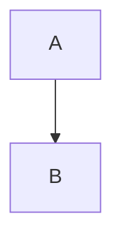

# عنوان

متن **پررنگ** و *کج* و `کد` و [پیوند](https://example.com)

<div dir="ltr">

Forced left to right

</div>

- یک
- دو

1. اول
2. دوم

- [x] انجام‌شده
- [ ] مانده

> نقل قول

> [!warning]
> هشدار

<details>
<summary>پرسش؟</summary>

پاسخ

</details>

```ts
const x = 1
```

$$
E=mc^2
$$




[گزارش.pdf](attachments/aaaaaaaaaaaaaaaaaaaaaaaaaaaaaaaaaaaaaaaaaaaaaaaaaaaaaaaaaaaaaaaa)

| الف | ب |
| --- | --- |
| ۱ | ۲ |

<table dir="rtl">
<tr><td colspan="2"><p>ادغام</p></td></tr>
</table>

<div class="nv-columns">

<div class="nv-column">

ستون یک

</div>

<div class="nv-column">

ستون دو

</div>

</div>

پیوند به [[صفحهٔ ایکس]] و فرمول $x^2$
